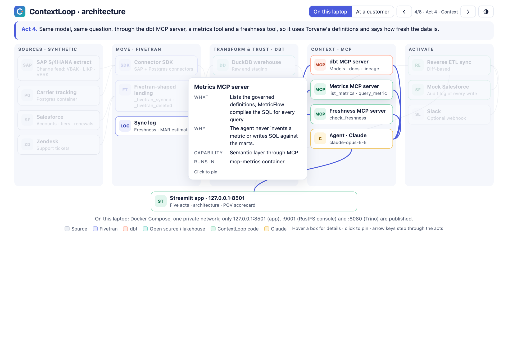
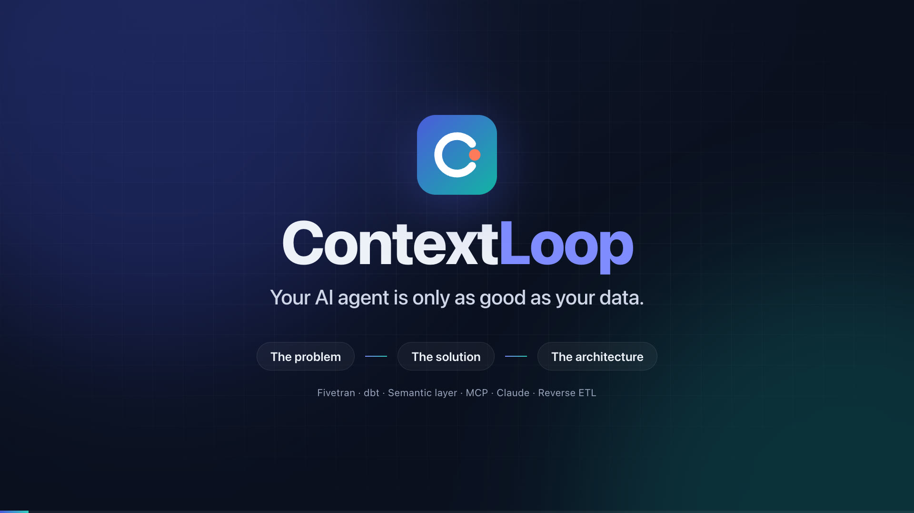

# ContextLoop: your AI agent is only as good as your data

ContextLoop is an end-to-end demo of why AI agents need a trusted data foundation, and how **Fivetran** (move), **dbt** (transform and trust), a **semantic layer with MCP** (context) and **reverse ETL** (activate) provide it.

It tells one story about one fictional customer. A chief operating officer asks an AI agent a real business question. The agent first answers from raw data and is **confidently wrong**. The demo then builds the data foundation one step at a time, asks the agent the **same question** again, and shows a correct answer with cited metric definitions, lineage and a data-freshness check. The answer is then pushed back into the tools the account team already uses.

> **Demo only.** All companies, accounts, orders, tickets and people are synthetic. ContextLoop doesn't connect to a real SAP system, Salesforce org or Zendesk instance, and doesn't write to any real CRM. Any resemblance to a real organization is coincidental.

> **Status: [Presentation](https://d36gkxgniq3znf.cloudfront.net/).** The narrated pitch is published for customers at https://d36gkxgniq3znf.cloudfront.net/ (a public watch page; anyone with the link can view it). Every component runs: connectors, dbt, metrics, lakehouse, MCP servers, both agents (3 recorded runs each: governed 6.0 of 6, naive 2.7), the five-act app, the without-vs-with comparison, the architecture page and pitch video, activation and the scorecard. What's left is two timed rehearsals (CL-16). Progress is tracked below and in the [MVP backlog](docs/mvp/INDEX.md).

**New here? Start with the [getting-started guide](docs/getting-started.md)**: setup, then a click-by-click walk through the demo with screenshots.

---

## Build progress

ContextLoop is built one story at a time: **build, test, close, repeat**. Each story has acceptance criteria and gets a completion record when it is done.

**Points done: 78 of 80 (98%).** Stories done: 17 of 18.

| Phase | Theme | Stories | Points | Target day | Status |
|---|---|---|---|---|---|
| 0 | Foundation and story (Docker) | CL-01, CL-02 | 6 | Wed 11 Nov | ✅ Done |
| 1 | **Move** (Fivetran) | CL-03, CL-04, CL-05 | 13 | Wed–Thu | ✅ Done |
| 2 | **Transform and Trust** (dbt) | CL-06, CL-07, CL-08 | 16 | Thu | ✅ Done |
| 3 | **Context** (MCP and the agent) | CL-09, CL-10, CL-11 | 14 | Fri 13 Nov | ✅ Done |
| 4 | **Experience** (Streamlit and architecture) | CL-12, CL-13, CL-17, CL-18 | 23 | Sat 14 Nov | ✅ Done |
| 5 | **Activate** and close | CL-14, CL-15, CL-16 | 8 | Sun 15 Nov | 🟡 In progress |

The full story list, dependencies and the cut line if time runs short are in [docs/mvp/INDEX.md](docs/mvp/INDEX.md).

---

## The story

### The customer

**Northstar Industrial** is a fictional mid-market maker of industrial valves, bearings and pumps, with about 120 business customers in North America and Europe. Its data lives in four systems that don't agree with each other:

| System | What it holds | Why it is hard |
|---|---|---|
| **SAP S/4HANA** (ERP) | Customers, sales orders, deliveries, billing | Cryptic table and column names (`VBAK`, `LIKP.WADAT_IST`), two currencies, cancelled orders still in the tables |
| **Salesforce** (CRM) | Accounts, account tier, renewal opportunities, owners | Account IDs don't match SAP customer numbers; one look-alike duplicate account; account tier changed during the quarter |
| **Zendesk** (support) | Support tickets, priority, tags | Free text; shipping complaints are tagged inconsistently |
| **Postgres** (carrier tracking service) | Shipment events: picked up, in transit, delivered | The *actual* delivery time lives here, not in SAP |

### The question

The COO asks the company's AI agent:

> *"Which of our strategic accounts are at risk because of late shipments, and what should the account teams do this week?"*

Answering correctly requires all four systems, one agreed definition of "on time", one agreed definition of "strategic", correct handling of deleted records, and data recent enough to act on.

### The five acts

The Streamlit app walks through the story in five acts. Each act maps to one of the data platform specialties a Fivetran sales engineering specialist covers.

| Act | Title | What the audience sees | Specialty it shows |
|---|---|---|---|
| 1 | **The confident wrong answer** | The agent, given raw SQL access only, names the wrong accounts with invented precision. A "what went wrong" panel lists each mistake: counted cancelled orders, used the planned instead of the actual ship date, mixed EUR and USD, double-counted a duplicate account, used stale data. | Why AI changes data requirements |
| 2 | **Move** | Fivetran-shaped connectors land all four sources. The SAP source and the Postgres carrier database are read by real **Fivetran Connector SDK** connectors: incremental sync with a cursor, checkpointed state, soft deletes (`_fivetran_deleted`), history mode on account tier, and a live schema change (a new column appears and flows through without breaking anything). A sync log shows freshness and an estimate of monthly active rows (MAR). | Database and application replication, SAP |
| 3 | **Transform and Trust** | A dbt project models raw data into staging, intermediate and mart layers, with tests, model contracts and lineage. A **semantic layer** (MetricFlow) defines `on_time_delivery_rate`, `net_revenue` and `account_risk_score` once. Trusted tables are written as **Apache Iceberg** and read by two engines. | Transformation, lake and warehouse architectures, open table formats |
| 4 | **Context** | The *same* agent, now working through the **dbt MCP server** (models, lineage, docs), a **metrics tool** (governed metric queries) and a **freshness tool** (sync timestamps). Side by side with Act 1: the right accounts, with the metric definitions cited, the lineage shown and a freshness badge. A scorecard compares both agents against known ground truth. | AI and context engineering, MCP, semantic layers |
| 5 | **Activate** | The at-risk list and recommended next steps are synced back to Salesforce (a local mock CRM, with a visible diff of inserts and updates) and posted to a Slack channel. The loop is closed: the insight reaches the people who act on it. | Activation and reverse ETL |

After Act 5, **The difference: without vs with** puts the two agents side by side on one page: score, data path, the account-by-account verdict and what each layer of the stack fixes. Then the **Proof-of-value scorecard** looks at the same demo through a sales engineering lead's eyes: the customer's success criteria with a pass or fail against each, time to value, a cost estimate based on MAR, and which specialist owns each workstream.

### Why this story

Customers moving to AI and agent workloads find that a model pointed at raw operational data gives fluent, confident and wrong answers. The fix is not a better prompt; it is reliable data movement, governed transformation and shared definitions that the agent can read. That is the combined Fivetran and dbt platform, and this demo makes the point in under ten minutes with a before-and-after the audience can check for themselves.

---

## Architecture

The demo runs entirely on a laptop, in **Docker containers started with one `docker compose` command**, so it can't be broken by a network outage, an expired trial or a missing local install. The only things needed on the host are Docker and `make`. The architecture page in the app shows the same design both as it runs here and as it would be deployed at a customer.

![ContextLoop architecture: four synthetic sources (Postgres carrier tracking, an SAP S/4HANA extract, Salesforce and Zendesk) flow into the Move layer, where Fivetran Connector SDK connectors and a Fivetran-shaped landing write raw tables and a sync log. In Transform and Trust, DuckDB holds the raw schemas, dbt Core builds tested models, MetricFlow defines the governed metrics, and dbt publishes trusted marts to an Iceberg REST catalog on RustFS (S3-compatible storage) that Trino also reads. In Context, the Claude agent calls the dbt MCP server, the metrics MCP server and the freshness MCP server. Its cited answer goes to the Streamlit app, and its at-risk list goes to a reverse ETL sync that writes to a mock Salesforce API and Slack.](docs/images/architecture.png)

The app's interactive **Architecture** page (also `contextloop/ui/architecture/index.html` on its own) steps through the acts, animates the Act 4 request flow and switches between this laptop and a customer deployment:



The diagrams in this README are HTML pages in [docs/diagrams/](docs/diagrams/). After editing one, run `python scripts/render_diagrams.py` (needs Playwright and Google Chrome) to regenerate the PNGs in `docs/images/`.

### Containers

Everything is defined in one `docker-compose.yml`. One application image (`contextloop`) holds the Python code, the Connector SDK, dbt, MetricFlow and the agent; it is reused with a different command for each job or service. The other services use pinned public images. There are no bind mounts: code is baked into the image and state lives in named volumes, so the only thing a laptop needs is Docker.

> **Object storage is RustFS, not MinIO.** MinIO's container images are no longer published on Docker Hub or Quay, so they cannot be pinned. [RustFS](https://github.com/rustfs/rustfs) (Apache-2.0) is S3-compatible and serves the same kind of console on port 9001.

![ContextLoop containers: the laptop browser reaches only three ports on 127.0.0.1: the app on 8501, Trino on 8080 and the RustFS console on 9001. Inside one private Docker network, the contextloop image runs the long-running app, mock-salesforce, dbt-mcp, mcp-metrics and mcp-freshness services, and the one-off datagen, sync, eval and build jobs. Pinned public images run trino (optional lakehouse profile), iceberg-rest, rustfs and postgres. The jobs write to the warehouse volume (the DuckDB file and sync log), which the long-running services open read-only; build publishes Iceberg tables through iceberg-rest; RustFS stores its data in the lake volume and Postgres in the pgdata volume.](docs/images/containers.png)

| Service | Image | Kind | What it does | Port |
|---|---|---|---|---|
| `postgres` | `postgres:17.11-alpine` | Long-running | The carrier tracking source database; seeded by `make data` | 5432 (internal) |
| `rustfs` | `rustfs/rustfs:1.0.4` | Long-running | S3-compatible object storage for the Iceberg data files | 9001 (console) |
| `lake-init` | `contextloop` | One-off, at `make up` | Creates the `lakehouse` bucket, then exits | — |
| `iceberg-rest` | `apache/iceberg-rest-fixture:1.10.1` | Long-running | Iceberg REST catalog over RustFS | internal |
| `trino` | `trinodb/trino:484` plus the catalog file |  Long-running, optional profile `lakehouse` | Second engine that reads the same Iceberg tables | 8080 |
| `mock-salesforce` | `contextloop` | Long-running | A small REST API standing in for Salesforce in Act 5, with an audit log of every write | internal |
| `mcp-metrics` | `contextloop` | Long-running | MCP server exposing `list_metrics` and `query_metric` (MetricFlow) over streamable HTTP | internal |
| `mcp-freshness` | `contextloop` | Long-running | MCP server exposing `check_freshness` (reads the sync log) over streamable HTTP | internal |
| `dbt-mcp` | `contextloop` | Long-running | The dbt MCP server against the dbt project and its latest build artifacts | internal |
| `app` | `contextloop` | Long-running | The Streamlit app; also runs the agent | 8501 |
| `datagen`, `sync`, `build`, `eval`, `test` | `contextloop` | One-off jobs (`docker compose run --rm`) | Generate data, run the connectors, run dbt and publish Iceberg, score the agents, run the tests | — |

Shared state lives in named volumes: `warehouse` (the DuckDB file, the connectors' state and the dbt artifacts), `data` (generated sources and the hidden truth), `lake` (RustFS data), `catalog` (the Iceberg catalog) and `pgdata`. Only the app (8501), the RustFS console (9001) and Trino (8080) are published, and only on `127.0.0.1`. DuckDB allows one writer at a time, so the jobs write `warehouse.db` and then publish a read-only copy, `serving.db`, which the long-running services open.

### Request flow for the headline question (Act 4)

![The headline question, before and after. In Act 1 the Claude agent has raw SQL access only, queries the DuckDB raw schemas and gives a confident, wrong answer: it counts cancelled orders, uses planned rather than actual ship dates, mixes EUR and USD, double-counts a duplicate account, uses a tier that changed mid-quarter and treats stale data as current. In Act 4 the same agent follows eight steps: ask in the Streamlit app, discover its MCP tools, read metric definitions with list_metrics, check freshness with check_freshness, query the governed metric with query_metric, fetch lineage from the dbt MCP server, write a cited answer, and score it against the ground truth. Both scores appear side by side on the scorecard.](docs/images/request-flow.png)

1. The user asks the question in the Streamlit app.
2. The agent (Claude) lists the tools it has: dbt MCP tools, `query_metric`, `list_metrics` and `check_freshness`.
3. It calls `list_metrics` and reads the definitions of `on_time_delivery_rate` and `account_risk_score`, including what "strategic" means.
4. It calls `check_freshness` and finds that every source synced within the agreed window. If one didn't, it would say so in the answer.
5. It calls `query_metric` grouped by account and filtered to strategic accounts. MetricFlow compiles governed SQL over the Iceberg marts.
6. It uses dbt MCP to fetch the lineage of the metric, so the answer can show where each number came from.
7. It writes the answer: the at-risk accounts, the drivers for each, the recommended next step, the metric definitions it used and the freshness of each source.
8. The app compares the answer with the known ground truth and shows the score next to Act 1's.

### Laptop demo compared with a customer deployment

| Layer | In this demo | At a customer |
|---|---|---|
| SAP replication | Fivetran Connector SDK connector, run with `fivetran debug` in a container, writing to DuckDB | Fivetran's native SAP connectors, or a hybrid deployment agent inside the customer's network |
| Database source | A real Postgres container, read incrementally by a second Connector SDK connector | Fivetran PostgreSQL connector (log-based change data capture) |
| SaaS sources | Synthetic tables in the exact layout Fivetran lands them in | Fivetran Salesforce and Zendesk connectors |
| Destination and lakehouse | DuckDB for raw and staging; trusted marts published as Iceberg tables to a REST catalog on RustFS (S3-compatible) | Fivetran Managed Data Lake Service writing Iceberg to S3, ADLS or GCS, or Snowflake, Databricks or BigQuery directly |
| Query engines | DuckDB and Trino reading the same Iceberg tables | Snowflake, Databricks, BigQuery, Athena or Trino on the same Iceberg tables |
| Transformation | dbt Core in a container | dbt platform, with scheduled jobs, CI and the hosted Semantic Layer |
| Semantic layer | MetricFlow, open source, in a container | dbt Semantic Layer |
| Agent context | dbt MCP server plus two small MCP servers, each in its own container | dbt MCP server (local or remote), connected to the dbt platform |
| Activation | A diff-based sync into a mock Salesforce API container, plus a Slack webhook | Fivetran Activations (reverse ETL) to Salesforce, Slack and other tools |
| Connectivity and security | A private Docker network; only three ports published, on localhost | Private networking (AWS PrivateLink, Azure Private Link, Google Private Service Connect), SSH tunnels, or hybrid deployment |

The interactive architecture page in the app shows both columns and lets you step through each act, lighting up the services involved.

Its **Build it up** mode shows how the architecture grows: Act 1 starts with the sources, a raw copy and the agent, and each act adds its layer (Move, Transform and trust, Context, Activate) until Act 5 completes the loop. Each act page opens with the same view for that act, under *Architecture after Act N*: what the act relies on, and what it adds.

### Pitch video

The Architecture page opens with a narrated, captioned **pitch video** (1920 × 1080, about five minutes) for briefing a customer: the problem, the confident wrong answer, the four-layer solution, then a walk through the real architecture diagram, act by act, including the eight-step request flow and the customer deployment view. Every number in it comes from the evaluation report.



- The script is [contextloop/ui/pitch/script.json](contextloop/ui/pitch/script.json), one voiced line ("beat") at a time, with the diagram cues for each.
- **Where it plays from:** the `.mp4` (about 95 MB) is git-ignored, like all video and audio. `make media-infra` creates (once) a private S3 bucket behind CloudFront (Terraform in [infra/media](infra/media)); `make publish-pitch` checks the render decodes cleanly, uploads it with its captions, poster and a public **watch page**, refreshes CloudFront, and records the links in `contextloop/ui/pitch/published.json`. The Architecture page then plays it from CloudFront and shows the watch-page link to share with customers (anyone with the link can view it). `CONTEXTLOOP_PITCH_URL` can point at another host, such as YouTube.
- `make pitch-video` renders it on the Mac host (macOS `say`, ffmpeg and `pip install playwright`). Each frame is captured from the pitch stage, which drives the real architecture page, so the video always matches the diagram.
- **Natural-sounding voice:** `make pitch-video ARGS='--tts google'` narrates with Google's Chirp 3 HD voice *Orus* (the current video), using your `gcloud auth login` and `GOOGLE_TTS_PROJECT` in `.env` (a project with the Text-to-Speech API enabled). `--tts elevenlabs` or `--tts openai` work too, with `ELEVENLABS_API_KEY` or `OPENAI_API_KEY` in `.env`; pick a voice with `--voice`. The script text is sent to that service, and the audio is cached in `data/out/tts-cache` so re-renders don't pay again.
- **Use your own voice:** record a take per beat as `recordings/voiceover/<beat id>.wav` (or `.m4a`) and re-render. The timing follows your takes. Without takes, the best installed macOS voice is used; a Premium voice (System Settings → Accessibility → Spoken Content → Manage Voices) sounds far more natural.
- Preview the stage in a browser without rendering: serve `contextloop/ui` (`python3 -m http.server -d contextloop/ui`) and open `/pitch/pitch.html?play`.

---

## Technology and why each piece is here

| Technology | Role in ContextLoop | Why it matters to the story |
|---|---|---|
| **Fivetran Connector SDK** | Builds the SAP-shaped and Postgres connectors in Python: `schema()` and `update()` functions, upserts, deletes and checkpointed state | Shows how Fivetran extends to any source, and how incremental sync, deletes and schema changes are handled |
| **Fivetran landing conventions** | System columns `_fivetran_synced`, `_fivetran_deleted`; history-mode columns `_fivetran_start`, `_fivetran_end`, `_fivetran_active` | These columns are what make raw data trustworthy, and what a naive agent ignores |
| **Docker and Docker Compose** | Runs every component: one application image plus pinned public images | One command to start, identical on any laptop, nothing to install but Docker |
| **PostgreSQL** (container) | The carrier tracking source database | A real database source with updates and deletes for incremental sync |
| **DuckDB** | Local warehouse for the raw and staging layers | Free, fast and embedded; the same SQL patterns apply in Snowflake, Databricks or BigQuery |
| **dbt Core** (`dbt-duckdb`) | Staging, intermediate and mart models; tests; model contracts; docs and lineage | The trust layer: one tested, documented version of each business entity |
| **MetricFlow** | Semantic models and metrics (`on_time_delivery_rate`, `net_revenue`, `account_risk_score`) | Gives the agent definitions instead of guesses; the core of context engineering |
| **Apache Iceberg** (PyIceberg, REST catalog, RustFS) | Open table format for the trusted marts | The open lakehouse pitch: land once, query from any engine, no lock-in |
| **Trino** (container) | A second engine reading the same Iceberg tables | Proves the "any engine" claim live, without a cloud account |
| **dbt MCP server** (`dbt-mcp`) | Lets the agent list models, read docs and lineage, and compile SQL | Shows how dbt's metadata becomes agent context through a standard protocol |
| **Model Context Protocol (MCP)** | Two small MCP servers: governed metric queries and source freshness | The standard way to give an agent tools and context |
| **Claude** (Anthropic API; `CONTEXTLOOP_MODEL`, recorded with `claude-haiku-5-5`) | The agent's model in both Act 1 and Act 4, so the only difference is the context it gets | A fair test: same model, same question, different data foundation |
| **Streamlit** | The five acts, the architecture page and the POV scorecard | Fast to build, easy to present, and the same pattern as DealPulse and WeekendWise |
| **Slack incoming webhook** (optional) | Receives the at-risk summary in Act 5 | Shows activation reaching where people already work |

---

## Data and the deliberate traps

The data generator creates the four source systems from one random seed, with a **known hidden truth**: the exact list of at-risk strategic accounts and the correct value of each metric. The app never reads the hidden truth; it is used only to score the agents' answers.

Six traps are planted on purpose. Each one is a real problem that data teams run into, and each one is something a naive agent gets wrong.

| # | Trap | Where it lives | What the naive agent does | What fixes it |
|---|---|---|---|---|
| T1 | **Soft-deleted records** | Cancelled SAP orders and deliveries kept with `_fivetran_deleted = true` | Counts them as real shipments | Staging models filter deleted rows; a dbt test enforces it |
| T2 | **Planned vs actual dates** | `LIKP.WADAT` (planned goods issue) vs carrier `delivered_at` | Measures on-time against the wrong date | One governed definition of `on_time_delivery_rate` |
| T3 | **Two currencies** | `VBAK.WAERK` is EUR or USD | Adds EUR and USD amounts together | Currency conversion in an intermediate model |
| T4 | **Identity mismatch** | Salesforce `Account.SAP_Customer_Number__c`, plus a look-alike duplicate account | Joins on name, double-counts or misses an account | A conformed `dim_account` with a uniqueness test |
| T5 | **Changed attributes** | Account tier changed from Standard to Strategic mid-quarter (history mode) | Uses the wrong tier for part of the period | History-mode columns and an as-of join |
| T6 | **Stale data** | The Zendesk sync is held two days behind in one scenario | Answers as if the data were current | The freshness tool, and the agent stating the gap |

The golden question set (six questions, including the headline question) and the expected answers are produced by the generator and checked into the evaluation step.

---

## Demo modes

| Mode | What runs | Needs |
|---|---|---|
| **Replay** (default) | All containers run locally; the agent steps are played back from recorded, checked runs | Docker only. Works with no internet once the images are pulled. This is the safe mode for a live presentation. |
| **Live** | The agent calls Claude in real time against the MCP server containers | Docker, plus an Anthropic API key in `.env` |

Both modes use the same data, the same dbt project and the same scoring, so a recorded run and a live run can be compared.

---

## Repository layout

```
contextloop/
├── README.md                  # this file
├── Makefile                   # wraps docker compose: run `make help`
├── Dockerfile                 # the contextloop application image
├── docker-compose.yml         # all services, volumes and the private network
├── docker/                    # service config: the Trino image with its Iceberg catalog
├── requirements.txt           # main environment, exact versions
├── requirements-connector.txt # Connector SDK environment, exact versions
├── .env.example               # mode, ANTHROPIC_API_KEY, SLACK_WEBHOOK_URL, scenario flag
├── connectors/
│   ├── sap_s4/                # Fivetran Connector SDK connector (connector.py, configuration.json)
│   └── carrier_pg/            # Connector SDK connector for the Postgres carrier tracking DB
├── contextloop/
│   ├── datagen/               # synthetic source systems, hidden truth, traps
│   ├── landing/               # Fivetran-shaped landing for the SaaS and Postgres sources, sync log
│   ├── agent/                 # naive agent, governed agent, MCP bridge, prompts
│   ├── mcp_servers/           # metrics and freshness MCP servers, and the dbt-mcp launcher
│   ├── activation/            # reverse ETL sync and Slack
│   ├── eval/                  # scoring, make eval / make record
│   ├── lakehouse/             # Iceberg publish and the two-engine comparison
│   └── ui/                    # Streamlit app: the five acts, architecture page, POV scorecard
├── dbt/contextloop/           # dbt project: models, tests, contracts, semantic models, metrics
├── data/                      # generator inputs (checked in) and out/ (git-ignored)
├── recordings/                # recorded agent runs for replay mode (written by make record)
├── reports/                   # evaluation reports (written by make record / make eval)
├── scripts/
│   ├── render_diagrams.py     # renders docs/diagrams/*.html to docs/images/*.png
│   ├── capture_guide.py       # drives the app and captures the getting-started screenshots
│   ├── render_pitch_video.py  # renders the narrated pitch video for the Architecture page
│   └── backlog_status.py      # updates story status in docs/mvp/INDEX.md and this README
├── tests/
└── docs/
    ├── diagrams/              # README diagrams as editable HTML (shared diagram.css and diagram.js)
    ├── getting-started.md     # setup and a click-by-click walk through the demo
    ├── images/                # rendered diagrams and guide screenshots
    ├── mvp/INDEX.md           # backlog: phases, stories, status
    ├── mvp/stories/           # one file per story
    ├── mvp/evidence/          # completion evidence
    └── demo/                  # narrative, talk track, runbook, Q&A, POV scorecard
```

## Commands

Every command runs in Docker; `make` is only a shortcut for the matching `docker compose` call.

| Command | What it does |
|---|---|
| `make images` | Builds the `contextloop` image and pulls the pinned public images |
| `make up` | Starts the long-running services (Postgres, RustFS, Iceberg catalog, MCP servers, mock Salesforce, app) |
| `make data` | Generates the synthetic source systems, seeds Postgres, and writes the hidden truth and golden questions |
| `make sync` | Runs both Connector SDK connectors and the SaaS landings into DuckDB, and writes the sync log |
| `make build` | Runs `dbt build` (models and tests), publishes the Iceberg marts and validates the semantic layer |
| `make lakehouse` | Starts Trino and runs the "same table, two engines" check |
| `make record` | Runs both agents live on the six golden questions (3 runs each), saves the recordings and the score report into the repo (needs an API key) |
| `make eval` | Re-scores the recordings against the hidden truth (or runs live with `CONTEXTLOOP_MODE=live`) |
| `make ask AGENT=governed Q=G1` | Runs one question live and prints each tool call |
| `make break TRAP=T1` | Re-introduces a trap so a named dbt test fails; `make build` restores it |
| `make demo` | `up`, `data`, `sync` and `build`, then opens the app at http://127.0.0.1:8501: the one command before a presentation |
| `make test` | Runs the test suite inside the stack |
| `make ps` | Show service status |
| `make logs` | Follow service logs |
| `make export` | Copy recordings/ and reports/ from the data volume into the repository |
| `make sdk-debug` | Run the SAP connector with Fivetran's own local tester (`fivetran debug`) |
| `make pitch-video` | Renders the narrated pitch video for the Architecture page (on the Mac host, not in Docker) |
| `make media-infra` | Creates the S3 bucket and CloudFront distribution that host the pitch video (once; Terraform, AWS sign-in) |
| `make publish-pitch` | Uploads the rendered pitch and its public watch page, and links it on the Architecture page |
| `make down` | Stops everything; `make clean` also removes the volumes |

---

## Scope guardrails

In scope: a local, reproducible demo that runs in Docker, with synthetic data, real Connector SDK code, a real Postgres source, real dbt models and tests, a real semantic layer, real Iceberg tables read by two engines, a real MCP-based agent, and simulated activation.

Out of scope for this MVP: connections to real SAP, Salesforce or Zendesk systems; a paid Fivetran or dbt platform account; cloud infrastructure (reading the Iceberg tables from Snowflake is a stretch goal only); Kubernetes; user login; real customer data; and any write to a real CRM.

## Related apps in this portfolio

- [DealPulse](../dealpulse/README.md): an AI deal-review assistant on AWS (SageMaker, OpenSearch, Claude on Bedrock).
- [WeekendWise](../weekendwise/README.md): a grounded AI weekend planner on Google Cloud (Vertex AI, Firestore, Cloud Run).
