# Getting started with ContextLoop

This guide takes you from a fresh clone to a rehearsed, ten-minute demo. It shows what to click, what you should see and what to point out to an audience at each step. Plan about 30 minutes the first time: 10 to set up, 10 to record the agent runs, 10 to walk the story.

> **Synthetic data only.** Northstar Industrial and every account, order, ticket and person in the demo are invented. Nothing connects to a real SAP system, Salesforce org, Zendesk instance or Slack workspace.

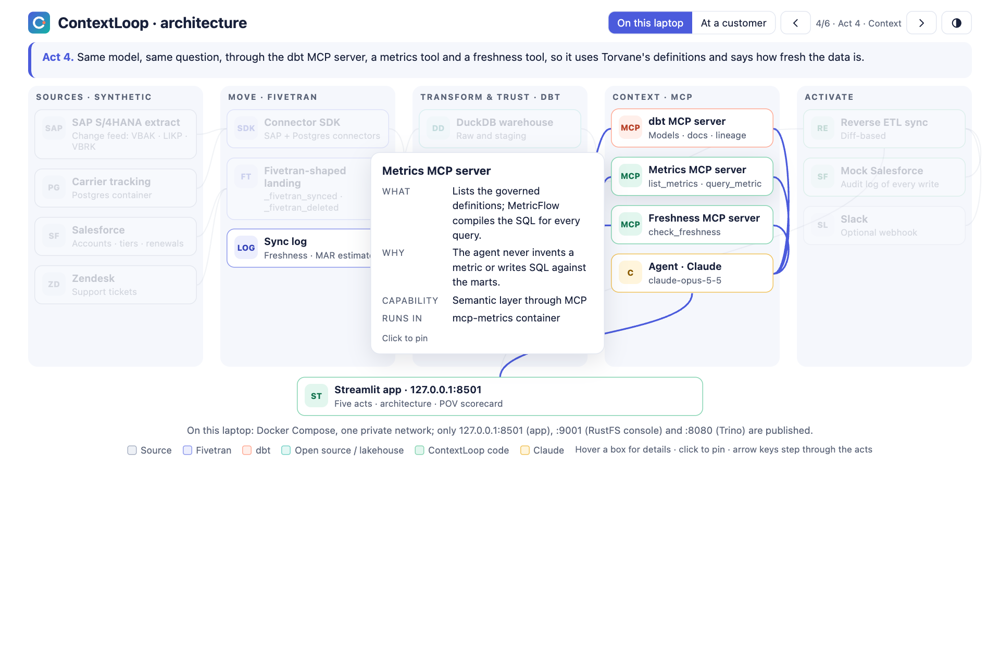

## What you are about to show

A COO asks an AI agent: *"Which of our strategic accounts are at risk because of late shipments, and what should the account teams do this week?"*

- **Act 1:** the agent answers from raw data and is confidently wrong.
- **Acts 2 and 3:** you build the data foundation. Fivetran-style replication moves the data, dbt models and tests it, MetricFlow defines the metrics, and Iceberg makes it readable by any engine.
- **Act 4:** the same agent answers again through MCP tools and gets it right, with definitions, lineage and a freshness warning.
- **Act 5:** the answer is pushed into the CRM.

A scorecard closes the demo as a proof of value.

## 1. Before you start

| You need | Why |
|---|---|
| Docker Desktop (or another Docker runtime with Compose v2), with about 8 GB of memory and 6 GB of disk for it | Everything runs in containers |
| `make` | The commands below are short wrappers around `docker compose` |
| An Anthropic API key (optional, but needed once) | To record the agent runs. After that, the demo replays them offline with no key |
| A Slack incoming-webhook URL (optional) | Act 5 posts a real message; without it you see a preview |

Nothing else is installed on your machine: no Python, dbt, Java or database.

## 2. Configure

```bash
cd apps/contextloop
cp .env.example .env
```

Open `.env` and set your key on its own line:

```bash
ANTHROPIC_API_KEY=sk-ant-api03-...
```

- **Use the right kind of key.** An Anthropic API key starts with `sk-ant-api03-` and comes from console.anthropic.com → API keys. A key in any other format is rejected with `401 Invalid bearer token`.
- **Keep comments on their own lines.** Docker Compose reads text after a value as part of it.
- **The secret stays local.** `.env` is ignored by git and by the Docker build, so the key never enters an image.

## 3. Build and start (about 5 minutes the first time)

```bash
make images     # builds the contextloop image and pulls the pinned images (Postgres, RustFS, Iceberg REST, Trino)
make demo       # starts the stack, generates the data, syncs it and builds the models, then opens the app
make lakehouse  # optional: starts Trino, the second query engine, and compares it with DuckDB
```

`make demo` runs four steps you can also run one by one:

| Step | What it does | You should see |
|---|---|---|
| `make up` | Starts nine services and waits until they are healthy | All services `healthy` in about 15 seconds |
| `make data` | Generates the four source systems from one seed and seeds Postgres | `At-risk strategic accounts: 9` in about 3 seconds |
| `make sync` | Runs both Connector SDK connectors with `fivetran debug`, lands Salesforce and Zendesk, and writes the sync log | A table of inserts, updates and deletes per table. Zendesk shows `FAILURE`: that is trap T6 (stale data), on purpose |
| `make build` | Runs `dbt build`, source freshness, the MetricFlow check and the Iceberg publish | `PASS=89 … ERROR=0`, `Source freshness: behind: zendesk`, `published 6 marts` |

The app is then at **http://127.0.0.1:8501**.

## 4. Record the agent runs (once, about 10 to 60 minutes)

Acts 1 and 4 replay recorded, scored runs, so the live demo never depends on the network. Record them once:

```bash
make record                           # 2 agents × 6 questions × 3 runs, plus one extra run for the stale-data toggle
CONTEXTLOOP_EVAL_RUNS=1 make record   # a quicker single pass (about 10 minutes)
```

- **Cost:** each run calls Claude up to about ten times. The report states the exact token count and cost of every run. Choose the model with `CONTEXTLOOP_MODEL` in `.env`; both agents always use the same one, so the comparison stays fair. Rough costs (an estimate, assuming about 60,000 input and 5,000 output tokens per question):

  | `CONTEXTLOOP_MODEL` | Quick pass (`CONTEXTLOOP_EVAL_RUNS=1`) | Full record (3 runs) |
  |---|---|---|
  | `claude-opus-5-5` (default, most capable) | about $3 to $5 | about $8 to $13 |
  | `claude-sonnet-5-5` | about $2 | about $5 |
  | `claude-haiku-5-5` | about $0.15 | about $0.40 |

  On a small budget, run a quick pass on Haiku first. If the governed agent scores 5 or 6 out of 6, record with it; otherwise move up to Sonnet. Anthropic credits are prepaid under Settings → Billing in the Console.
- **What you get:** the recordings land in `recordings/` and the score report in `reports/`. Commit both.
- **What a good result looks like:** the governed agent scores 5 or 6 out of 6 and the naive agent 2 or fewer.

To watch a single question run live before recording everything:

```bash
make ask AGENT=governed Q=G1
```

You can skip recording and present in **Live mode** instead: use the toggle in the app's sidebar, which is enabled when a key is set. Replay is the safer choice in front of an audience.

## 5. Walk the story

Use **Next →** at the bottom of each page, or the navigator on the left. The sidebar shows whether you are in **REPLAY** or **LIVE** mode. The words to say for each act are in the [talk track](demo/talk-track.md).

### Opening: the customer and the question

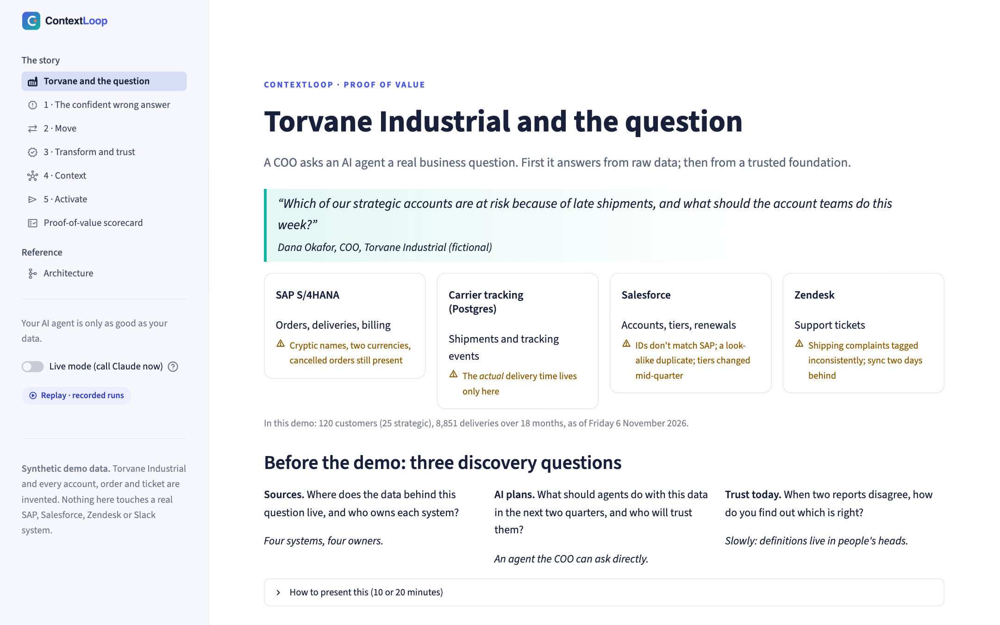

Introduce Northstar's four systems and what makes each one hard. Then ask the three discovery questions, so the demo lands as a proof of value rather than a feature tour.

### Act 1: The confident wrong answer

> **Screenshots for Acts 1 and 4 show the app before `make record`.** Until the recordings exist, both acts say "No recorded run yet". After `make record`, run `python scripts/capture_guide.py` to refresh every screenshot in this guide with the recorded runs.

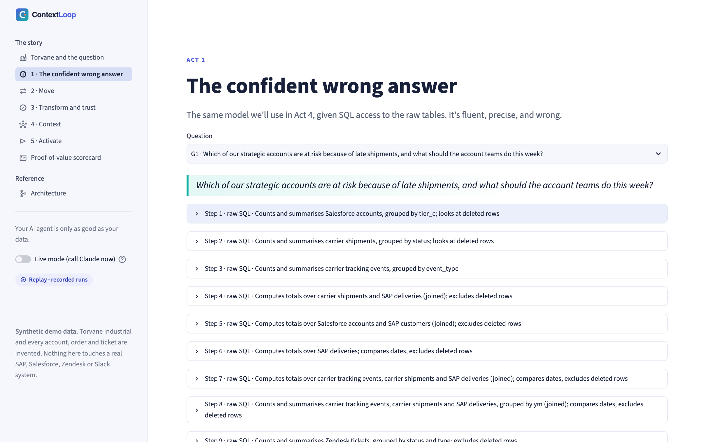

1. Leave question **G1** selected and press **Ask the agent**. The recorded run replays: every SQL statement the agent wrote, then its answer.
2. Point at the score badge. It is checked against a hidden truth that the agents never see.
3. Walk two or three **What went wrong** cards. Each names a trap (for example, cancelled deliveries counted as late, or ship dates used as delivery dates), quotes the SQL line responsible, and says which act fixes it.

**Point out:** it's the same model as in Act 4. A better prompt can't fix this, because the model can't know what "on time" or "strategic" means at Northstar.

### Act 2: Move

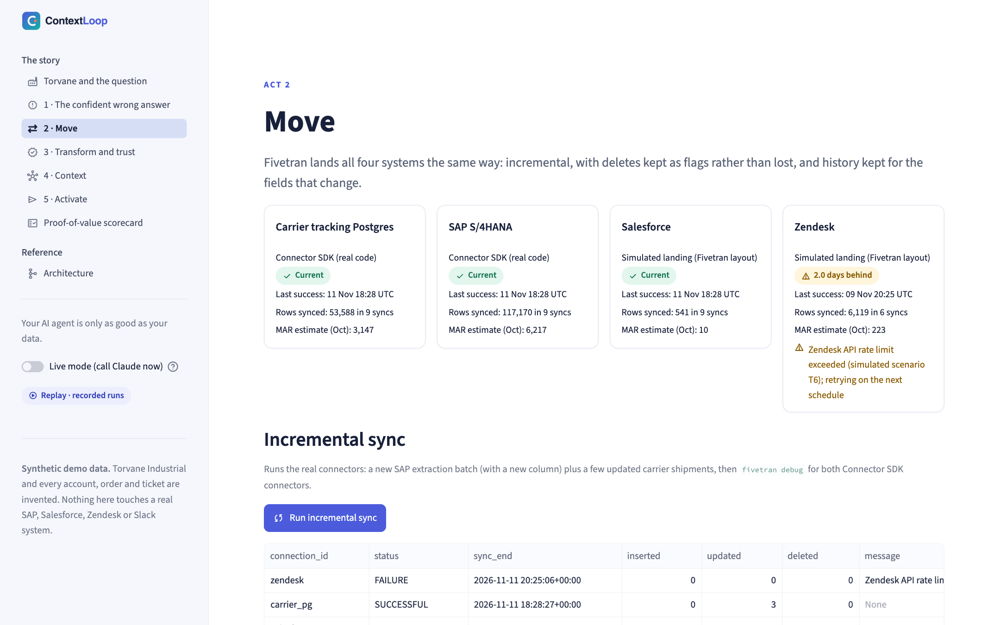

The four cards come from the sync log. SAP and the carrier database are **real Connector SDK code**; Salesforce and Zendesk are **simulated landings** in Fivetran's layout. Zendesk shows **2.0 days behind**: remember that for Act 4.

Press **Run incremental sync**. It runs real jobs: a new SAP extraction batch that adds a column, a few updated carrier shipments, then `fivetran debug` for both connectors.

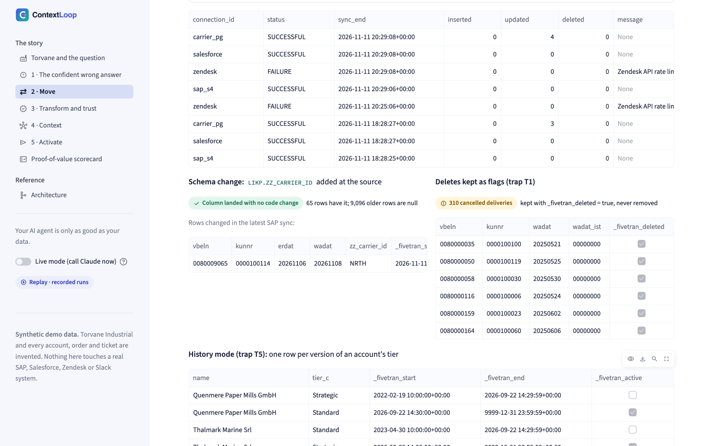

**Point out:**

- Only the changed rows synced.
- `ZZ_CARRIER_ID` appeared with **no connector code change**.
- 310 cancelled deliveries are kept with `_fivetran_deleted = true` rather than lost.
- History mode keeps both versions of an account whose tier changed mid-quarter.

Open **Go deeper** to show the connector's `update()` function and the MAR estimate.

### Act 3: Transform and trust

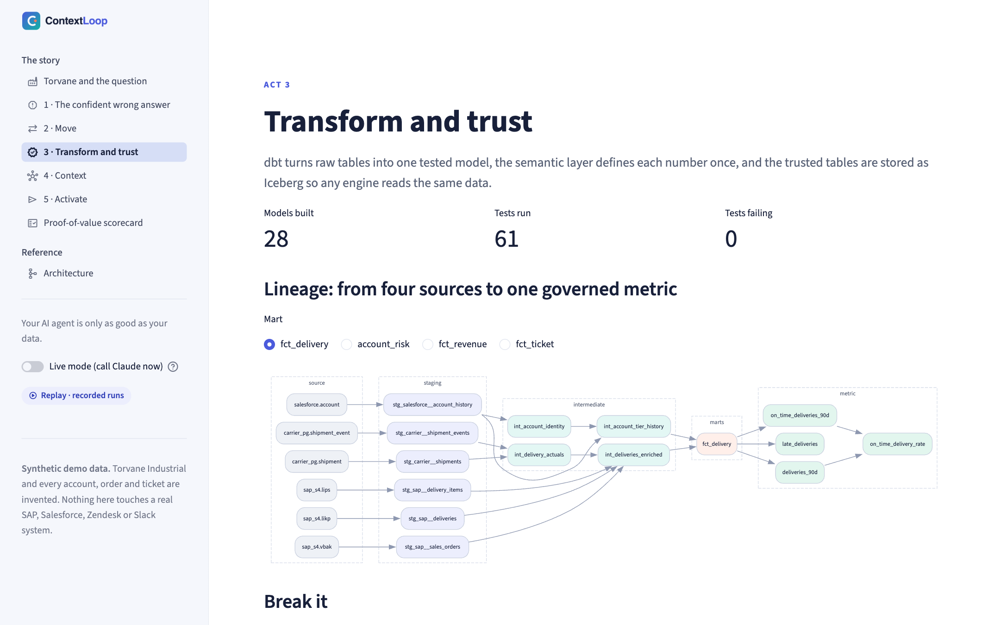

The lineage graph is drawn from the dbt manifest of the last build. Switch the **Mart** selector to `account_risk` to show all four sources feeding one model.

Press **Break it, then restore**. It runs `dbt build` with the cancelled-delivery filter removed, shows the named tests that fail, and then rebuilds the trusted version.

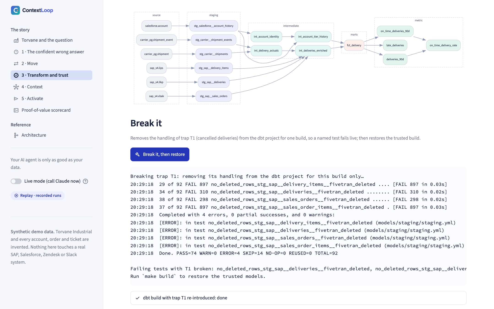

Then press **Run the at-risk query on DuckDB and Trino**.

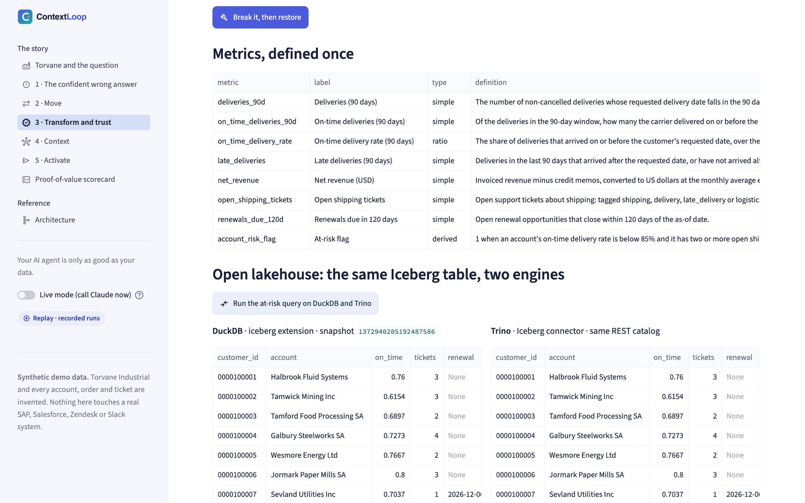

**Point out:**

- Definitions live in code and are tested on every build.
- A broken assumption fails loudly.
- The trusted tables are stored once, in an open format, and any engine reads them.

### Act 4: Context

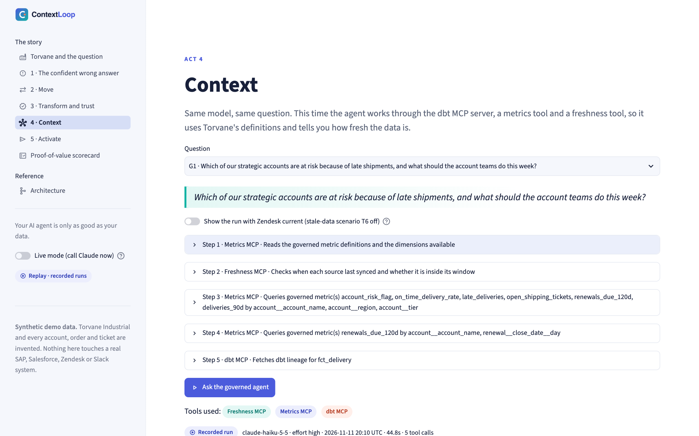

1. Press **Ask the governed agent**. Each tool call is labelled by its MCP server (dbt MCP, metrics or freshness).
2. Open a `query_metric` step to show the SQL that MetricFlow compiled. The agent never writes SQL against the marts itself.
3. Show the answer: the nine at-risk accounts with drivers and a next step, the definition of every metric it used, the lineage, and a **Zendesk STALE** badge with a caveat.
4. Turn on **Show the run with Zendesk current** to compare the answer when the support data is fresh.
5. Scroll to **Side by side with Act 1** and **All six golden questions**: the same model and questions, with only the context changed.

**Point out:** context engineering is data engineering. The agent is only as good as the definitions and data it can reach.

### Act 5: Activate

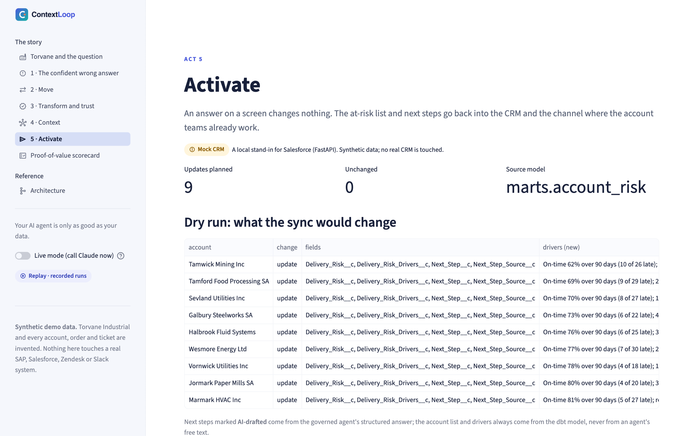

The dry run shows exactly what would change in the (mock) CRM. The account list and drivers come from the dbt model `marts.account_risk`; next steps marked **AI-drafted** come from the governed agent's structured answer. Press **Sync to Salesforce**.

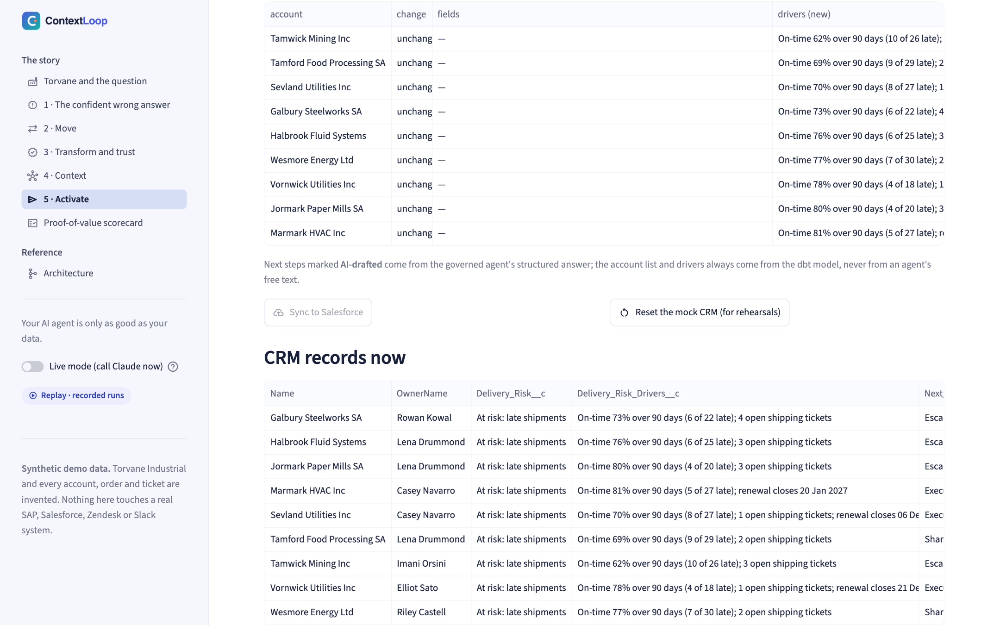

**Point out:**

- A second dry run shows nothing to change, because the sync is diff-based.
- Every write is in the audit log with its source model.
- The Slack message is previewed, or posted if you set a webhook.

### Close: the proof-of-value scorecard

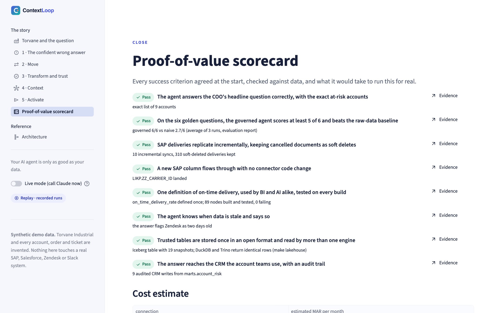

Each success criterion is checked live, against the recordings, the warehouse and the mock CRM, and links to the act that proves it. Close on the path to production and the specialist map. The next step is a scoped pilot, not another demo.

### Reference: the architecture page

The **Architecture** page works inside the app, or on its own by opening `contextloop/ui/architecture/index.html` in a browser.

- Hover a box for details; click to pin the card.
- Use ← and → to step through the acts, highlighting the services involved.
- At the last step, press **▶ Play request flow** to animate the eight steps of the headline question.
- Switch to **At a customer** for the production equivalent of every component.

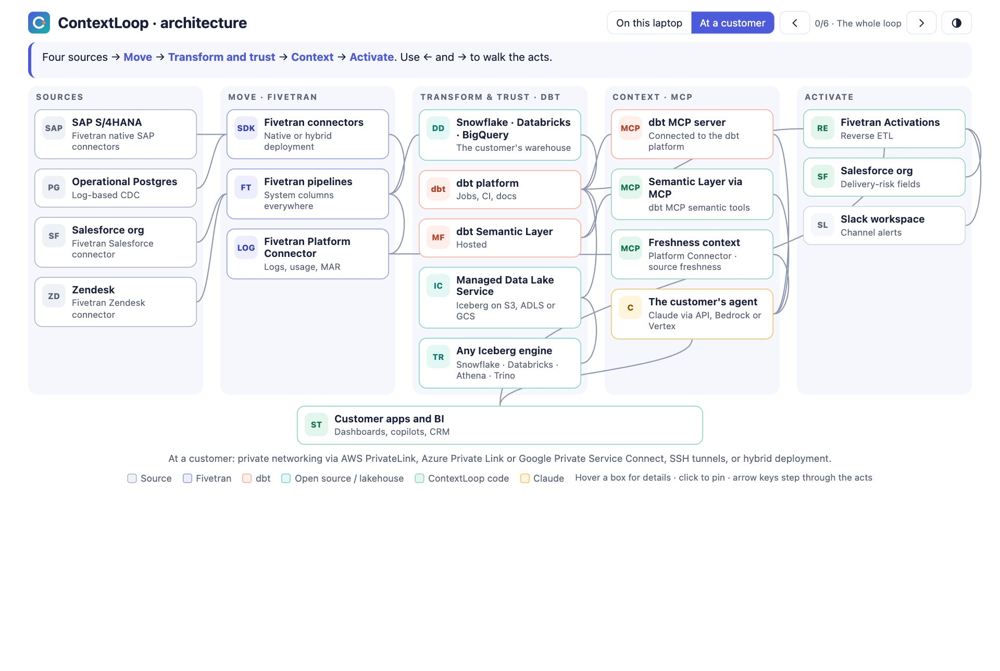

## 6. Check that everything works

```bash
make test       # about 100 tests inside the stack: data, connectors, dbt, metrics, lakehouse, MCP, agents, activation, app pages
make eval       # re-scores the recordings against the current hidden truth (no API calls in replay mode)
make lakehouse  # DuckDB and Trino return identical rows from the same Iceberg table
```

## 7. Between rehearsals

| To | Run |
|---|---|
| Clear the CRM before a run-through | **Reset the mock CRM** in Act 5 |
| Start the data from scratch, so the incremental sync and schema change show again (keeps the images and recordings) | `make clean && make demo` |
| Refresh the screenshots in this guide | `python scripts/capture_guide.py` (needs Playwright and Chrome on the host) |

## 8. If something goes wrong

| Symptom | Fix |
|---|---|
| The app says "The warehouse is empty" | Run `make demo` (or `make data`, `make sync`, `make build`) |
| Acts 1 and 4 say "No recorded run yet" | Run `make record` once with a key, or switch to Live mode |
| `401 Invalid bearer token` | The key isn't an Anthropic API key (`sk-ant-api03-…`); create one at console.anthropic.com |
| Live mode toggle is greyed out | `ANTHROPIC_API_KEY` is empty in `.env`; restart with `make up` after setting it |
| Trino panel says Trino isn't running | `make lakehouse` (Trino is optional) |
| A service is unhealthy | `make ps`, then `docker compose restart <service>`; `make logs` shows why |
| Docker can't mount `~/Documents/...` | Not needed: ContextLoop uses no bind mounts. Everything is in images and named volumes |
| Something breaks during a live demo | Switch to Replay mode in the sidebar; the recorded runs need no network. The [runbook](demo/runbook.md) has the full list |

## Command reference

| Command | What it does |
|---|---|
| `make help` | Lists every command |
| `make images` | Builds the app image and pulls the pinned images |
| `make up` / `make down` / `make clean` | Starts, stops, or stops and deletes the data |
| `make data` / `make data BATCH=2` | Generates the sources / adds the schema-change batch |
| `make sync` | Runs the connectors and landings, and writes the sync log |
| `make build` | Runs dbt build, freshness, the semantic layer check and the Iceberg publish |
| `make break TRAP=T1` (or `T4`) | Re-introduces a trap so a named dbt test fails; `make build` restores it |
| `make lakehouse` | Starts Trino and compares the two engines |
| `make ask AGENT=governed Q=G1` | Runs one question live and prints each tool call |
| `make record` / `make eval` | Records and scores the agents / re-scores the recordings |
| `make test` | Runs the test suite inside the stack |
| `make sdk-debug` | Shows the SAP connector's full `fivetran debug` output |
