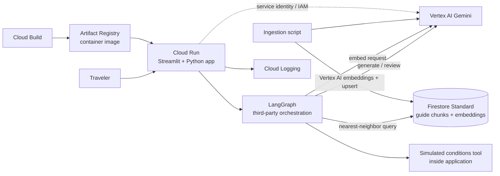

# Google technology brief — WeekendWise demo

This brief explains the Google Cloud services in the simplified WeekendWise AI Trip Planner. It is written as a quick learning guide, not a deployment manual.

## Google technologies in the MVP

### 1. Firestore vector search

**Plain English:** Firestore is Google Cloud’s managed document database. Its vector search feature can find stored records whose embedding vectors are semantically close to a query vector.

**How WeekendWise uses it:** Store each destination-guide chunk, source metadata, and its embedding in Firestore. When a traveler asks for an itinerary, the backend asks Vertex AI to embed the question, then queries Firestore for the most relevant chunks. The returned passages and citations go to Gemini to draft the itinerary.

**Important distinction:** Firestore stores and searches vectors; it does **not** create the embeddings. Vertex AI creates both document and query embeddings. The same embedding model and compatible vector dimensions must be used for indexing and querying.

**Why it helps an online SaaS app:** The corpus is stored centrally instead of copied into every Cloud Run container. Content can be updated without rebuilding the app image, and multiple service instances query the same collection. Metadata can be used to scope results, for example by destination or tenant, with access checks enforced by the backend.

**Trade-offs:** It adds database setup, vector/composite index setup, IAM permissions, ingestion/update code, and usage charges. For this MVP, the corpus is small and costs should be measured; the default Firestore database has a published free quota, but vector-index entry reads and usage above quotas can be billed. A budget alert is not a spending cap.

**Status:** Firestore is included in the current [MVP stories](../../docs/mvp/README.md). The corpus is ingested into Firestore; Cloud Run uses read-only access for retrieval, while a separate approved developer/ingestion identity writes the guide chunks.

### 2. Vertex AI

**Plain English:** Google Cloud’s managed platform for using AI models and related machine-learning services.

**How WeekendWise uses it:** The app sends a traveler’s request to a Gemini model for planning and review. It also asks a text-embedding model to turn the query and destination-guide passages into numerical representations for meaning-based matching.

**Why it matters:** You can demonstrate model integration, prompting, embeddings, retrieval-augmented generation (RAG), and an evaluation/review step using Google’s AI platform. The model is called from the server—not directly from the browser—and the app’s Google Cloud service identity authorizes the call.

**Useful distinction:** Gemini generates and evaluates text. Embeddings represent text as vectors so the app can find passages that are semantically similar to a question. They serve related but different purposes.

### 3. Cloud Run

**Plain English:** A managed service that runs a containerized web application without requiring you to manage virtual machines or a Kubernetes cluster.

**How WeekendWise uses it:** It hosts the Streamlit web app and its Python/LangGraph backend behind an HTTPS endpoint. It can scale down when nobody is using the demo, which helps keep an interview project inexpensive.

**Why it matters:** This is the app’s hosting/runtime layer. Cloud Run does not create the itinerary or provide the model; it runs the code that calls Vertex AI and returns the result to the user.

### 4. Cloud Build

**Plain English:** A managed build service that turns source code into a deployable artifact using a sequence of build steps.

**How WeekendWise uses it:** It can build the app’s container image and, in a later automation step, publish that image for deployment.

**Why it matters:** It demonstrates a basic repeatable build-and-release workflow. It is not the application host and does not replace LangGraph.

### 5. Artifact Registry

**Plain English:** Google Cloud’s private repository for storing software artifacts, including container images.

**How WeekendWise uses it:** Cloud Build publishes the WeekendWise container image here; Cloud Run uses that image to start the app.

**Why it matters:** It is the handoff point between building the app and running it. It is not a source-code repository or a database for trip documents.

### 6. Cloud Logging

**Plain English:** A managed destination for application and platform logs.

**How WeekendWise uses it:** The app writes structured events such as request ID, workflow step, model name, latency, and error category. Avoid logging sensitive user details or full prompts by default.

**Why it matters:** It helps explain and troubleshoot the live demo. Logs can show that the workflow retrieved information, called the simulated conditions tool, and completed review without exposing the model’s private reasoning.

### 7. Google Cloud project, billing, and IAM service identity

**Plain English:** A Google Cloud project is the administrative and billing boundary for resources. IAM controls who or what is allowed to use them. A service identity is the app’s own identity when it calls Google APIs.

**How WeekendWise uses them:** The project holds the Cloud Run service, build artifacts, and Vertex AI access. The Cloud Run service account should receive only the permissions it needs, such as calling the selected Vertex AI APIs and writing logs. No downloaded service-account key should be embedded in the code or container.

**Why it matters:** These foundations are easy to overlook in a demo but important in real customer deployments: ownership, authorization, cost visibility, and least privilege.

## Technologies used alongside Google Cloud

These are part of the demo stack, but they are **not Google Cloud products**:

- **LangGraph:** a third-party Python framework used to define the agent workflow, state, branching, and bounded review loop.
- **Streamlit:** an open-source Python framework used to make the demo web interface.
- **Python and the container image:** the application language and packaging format.
- **Local corpus preparation/indexing script:** a Python command reads the checked-in Markdown guides, calls Vertex AI to embed chunks, and writes chunk records and vector values to Firestore. Query-time nearest-neighbor search is performed by Firestore, not by a local in-memory index.

This split is useful to state accurately in an interview: Google provides the model/API and cloud platform services; LangGraph coordinates the application’s agent workflow.

## Other services not in the current MVP stories

The current simplified build and stories do **not** use BigQuery, Cloud Storage, Firebase Authentication, Vertex AI Vector Search, or Vertex AI Agent Engine. These remain optional follow-ups. Adding services increases setup and hosting cost, so include them only when their benefits justify the work.

Possible later extensions:

- **Vertex AI Vector Search:** consider it only if measured corpus size, concurrency, or retrieval requirements exceed the Firestore MVP design.
- **Cloud Storage:** keep source destination guides outside the application image and support ingestion/update workflows.
- **Firebase Authentication:** add Google sign-in if the public demo needs individual user accounts.
- **BigQuery:** add analytics, such as aggregate itinerary requests or evaluation results, if the demo needs an analytics story.
- **Vertex AI Agent Engine:** evaluate managed agent runtime capabilities if they solve a concrete deployment or operations requirement. It is not needed just to use an agent framework.

## End-to-end service map

## Quick mental model

- **Vertex AI** is where the app asks Google-hosted AI models to do work.
- **LangGraph** decides the steps and when a tool or reviewer is needed.
- **Cloud Run** runs the web application and backend code.
- **Cloud Build** packages the code; **Artifact Registry** stores the package.
- **Cloud Logging** records operational events.
- **IAM** controls the app’s access to Google Cloud services.
- **Firestore vector search** stores guide chunks and vectors and performs nearest-neighbor retrieval; Vertex AI generates the vectors.

Google product names and APIs can change. Check the linked official documentation and current model availability/pricing before building or deploying.

## Official documentation

- [Vertex AI generative AI overview](https://cloud.google.com/vertex-ai/generative-ai/docs/learn/overview)
- [Vertex AI text embeddings](https://cloud.google.com/vertex-ai/generative-ai/docs/embeddings/get-text-embeddings)
- [Firestore vector search](https://cloud.google.com/firestore/docs/vector-search)
- [Firestore pricing](https://cloud.google.com/firestore/pricing)
- [Cloud Run overview](https://cloud.google.com/run/docs/overview/what-is-cloud-run)
- [Cloud Build overview](https://cloud.google.com/build/docs/overview)
- [Artifact Registry overview](https://cloud.google.com/artifact-registry/docs/overview)
- [Cloud Logging overview](https://cloud.google.com/logging/docs/overview)
- [IAM overview](https://cloud.google.com/iam/docs/overview)
