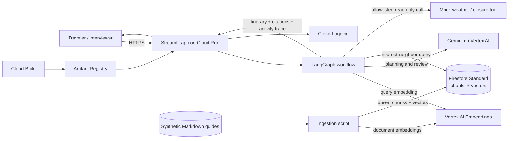

# Simplified demo plan: WeekendWise AI Trip Planner

**Recommendation:** Build this as the relatable, customer-facing SaaS demo. Trip planning is familiar to most people, and the workflow naturally demonstrates the job’s requested stack: agent orchestration, tool use, collaboration, RAG, Gemini/model API integration, evaluation, and a working prototype.

## Demo in one sentence

A traveler asks for a weekend itinerary with dates, budget, interests, and constraints; a LangGraph workflow retrieves destination-guide passages, optionally checks a safe synthetic weather/closure tool, then Gemini creates a cited itinerary that a reviewer step checks for evidence, budget fit, and consistency.

## A concrete demo story

“Plan a three-day San Francisco weekend for two people, under $600 excluding flights, with art museums and coffee shops. We prefer public transit and want an indoor alternative if Saturday is rainy.”

The app returns a day-by-day draft, approximate cost ranges, cited guide passages, a simulated weather/closure check, and alternatives if the conditions or budget do not fit. It should clearly label fixture-based data as **simulated**, not live bookings or guaranteed prices.

## Keep the stack intentionally small

| Need | Choice | What it demonstrates |
|---|---|---|
| Agent orchestration | **LangGraph** in Python | Explicit graph, state, conditional routing, bounded retries |
| Model and embeddings | **Gemini and text embeddings through Vertex AI** | Google model API integration, prompting, embeddings, model selection |
| Vector database / RAG | **Firestore Standard vector search** stores guide chunks, metadata, and embeddings; **Vertex AI** creates embeddings | Managed persistent storage, nearest-neighbor retrieval, metadata pre-filters, and cited RAG |
| Agent tool | One allowlisted `check_local_conditions` tool returning fixed synthetic weather and closure data | Tool schema, tool selection, argument validation, safe execution |
| Collaboration / verification | Itinerary planner step + reviewer step in the same LangGraph | A simple collaboration pattern that checks citations, budget arithmetic, and constraints |
| Web app and hosting | **Streamlit on Cloud Run** | A shareable customer-facing prototype and serverless deployment |
| Build and image storage | **Cloud Build + Artifact Registry** | Basic repeatable deploy path |

**Do not add yet:** BigQuery, Cloud Storage (other than the Terraform state bucket), Vertex AI Vector Search, Firebase login, Agent Engine, Kubernetes, multiple agent frameworks, live booking integrations, or a complex frontend. Infrastructure is provisioned and destroyed with Terraform (`make bootstrap`, `make apply`, `make destroy-all`); see `docs/mvp/guides/00-provision-with-terraform.md`. The small four-city corpus keeps the Firestore dataset inexpensive and understandable; this does not demonstrate production-scale retrieval.

## Architecture

### One request, end to end

1. The user selects a destination scenario or enters destination, dates, party size, budget, interests, and constraints.
2. LangGraph creates a small request state, asks Vertex AI to embed the query, and retrieves relevant destination/attraction chunks from Firestore using nearest-neighbor search and a server-side city/active filter.
3. The planner node decides whether the synthetic weather/closure tool is relevant. The tool accepts an allowlisted city and fixed demo date/scenario and returns clearly marked fixture data; it cannot book, purchase, or change anything.
4. Gemini drafts an itinerary constrained by the user’s budget, preferences, and retrieved evidence. It cites source IDs and labels cost estimates as approximate.
5. The reviewer checks citation validity, required preferences, date/condition consistency, and simple budget math. It permits one bounded revision; if evidence is weak or the budget cannot be supported, it flags assumptions or asks a follow-up instead of fabricating certainty.
6. The UI shows a day-by-day itinerary, cost estimate, alternatives, cited source passages, and sanitized trace such as “retrieved three city guides → checked simulated conditions → verified budget and citations.” Do not expose hidden chain-of-thought.

## Build sequence

### 1. Prepare destination scenarios and corpus — 3–5 hours

- Cover four cities (San Francisco, Portland, Santa Cruz, and Napa Valley); San Francisco is the main scripted demo, and each other city has one scripted scenario.
- Write at least 10 short Markdown documents per city: neighborhood overviews, attraction descriptions, opening-hour notes, transit tips, coffee/food recommendations, accessibility notes, and price ranges. Use original fictional or carefully sourced factual demo content; do not copy copyrighted travel-guide text.
- Include one outdated/conflicting guide and one out-of-corpus request so the demo can show verification and uncertainty.
- Create three repeatable scenarios: (a) budget + interest itinerary, (b) rainy-day request using the conditions tool, and (c) impossible/unsupported request that should trigger a follow-up or caveat.

**Done when:** Each script question has expected evidence, tool behavior, and acceptable budget/constraint outcomes.

### 2. Configure Firestore and ingest the corpus — 5–8 hours

- Follow [Firestore setup guide 04](../../docs/mvp/guides/04-firestore-vector-search.md) to create the default Firestore Standard database in the selected region and the vector index for the configured Vertex AI embedding dimension.
- Split the Markdown into stable chunks with title, section, source ID, city, active/version status, and last-reviewed metadata.
- Run an idempotent ingestion command using Vertex AI text embeddings and upsert vectors and chunk metadata to Firestore. Use a developer/ingestion identity for writes; keep Cloud Run runtime access read-only.
- Add tests for index readiness, vector dimension validation, ingestion failures, and repeat-ingestion without duplicates.

**Done when:** The vector index is ready, the corpus is in Firestore with stable IDs/metadata, and re-ingestion is safe.

### 3. Add Firestore retrieval and citations — 4–7 hours

- Embed each traveler query with the same Vertex AI model used during ingestion.
- Run a Firestore nearest-neighbor query with bounded top-k (for example 3–5), a server-side city/active pre-filter, and an appropriate distance threshold.
- Return chunk text, source IDs, title/section, and distance metadata to the workflow; do not expose Firestore client access to the browser.
- Add tests for expected matches, empty/low-relevance results, filter behavior, missing indexes, permissions, timeouts, and citation resolution.

**Done when:** Known questions for each supported city retrieve expected Firestore documents and unsupported/out-of-scope questions return insufficient evidence.

### 4. Add LangGraph orchestration and the tool — 6–10 hours

- Define a typed graph state: user constraints, retrieved evidence, condition result, draft itinerary, citations, budget summary, verification status, and bounded retry count.
- Add nodes for request normalization, retrieval, planning, optional tool execution, review, and final response.
- Implement one read-only mock tool such as `check_local_conditions(city, demo_date)`, returning fixed synthetic weather/closure data for the seeded scenario.
- Validate all arguments and allow only the seeded city/date combinations. No shell, arbitrary URL fetching, payment, reservation, account mutation, or arbitrary code tool.
- Limit tool calls to one and revision/review attempts to one. Add timeouts and a helpful fallback if a Vertex call fails.

**Done when:** The rainy-day scenario invokes the tool, a regular destination question can skip it, and an unsupported itinerary is qualified rather than invented.

### 5. Create the simple web demo — 4–6 hours

- Build a Streamlit page with destination/date/party/budget/interests fields, scenario buttons, itinerary cards, citation expanders, and a compact graph-step trace.
- Add a visible “demo content and conditions are simulated; no reservations are made” notice and a small feedback control.
- Keep all Gemini calls server-side. Do not put credentials in the browser or repository.
- Add graceful loading/errors and make the result understandable to a non-ML interviewer.

**Done when:** A fresh browser session can complete all six scripted examples.

### 6. Evaluate, deploy, and rehearse — 6–10 hours

- Build 15–25 test requests: answerable, tool-needed, budget-constrained, ambiguous, adversarial-document, and out-of-scope.
- Track citation validity, retrieval hit@k, correct tool selection/arguments, budget/constraint adherence, abstention behavior, response latency, and model token use.
- Run a prompt-injection test in which a retrieved guide tells the agent to ignore constraints or reserve a service; confirm it cannot expand tool permissions or make bookings.
- Containerize the Streamlit app, build using Cloud Build, push to Artifact Registry, and deploy to Cloud Run in one region.
- Set Cloud Run max instances and request limits conservatively. If the demo is public, use only synthetic data and monitor usage; budget alerts notify but do not stop spend.
- Rehearse a 3–5 minute walkthrough and keep a short screen recording as a fallback.

**Done when:** A public or interviewer-accessible URL works, the test report is saved, and the architecture/limitations are explainable.

## Estimated effort and difficulty

**Difficulty: about 4/10** if Python basics are comfortable; around **6/10** if LangGraph and Google Cloud IAM are both new. The hard parts are controlling agent behavior and making retrieval/citations reliable—not operating infrastructure.

| Stage | Focused effort |
|---|---:|
| Scenario and synthetic docs | 3–5 hours |
| Firestore setup and corpus ingestion | 5–8 hours |
| Firestore retrieval and citations | 4–7 hours |
| LangGraph and safe tool use | 6–10 hours |
| Streamlit UX | 4–6 hours |
| Evaluation, Cloud Run deploy, rehearsal | 6–10 hours |
| **Total** | **28–46 hours** |

A reasonable schedule is **3–6 weeks at 8–10 hours/week**, including learning and troubleshooting. Leave another week of buffer if new to Google Cloud deployment, Firestore vector indexes, or Vertex AI IAM.

## Indicative GCP hosting cost

Planning range for a low-traffic interview demo in one US region, using Cloud Run scale-to-zero and Firestore Standard’s default database: **about $5–$30/month**. This assumes a few hundred itinerary requests/month, a small guide corpus, modest vector-search reads, limited logs/egress, and no always-on minimum instance. It is an estimate, not a quote; prices and free-tier eligibility vary.

Gemini generation is the main variable cost. Under the published Gemini 3.8 Flash introductory pricing through December 31, 2026 ($0.75 per million input tokens and $3.75 per million output tokens at the global endpoint), an investigation averaging about 5,000 input and 1,000 output tokens across graph model calls costs roughly **$0.0075**, or **about $7.50 per 1,000 itinerary requests**. Actual token counts depend on the prompt, evidence, and review call. Published prices are scheduled to change January 1, 2027, so re-check before deployment. Embedding the tiny corpus is a one-time cost; per-query embedding usage should be small.

The Firestore Standard default database has published free quotas (including 1 GiB stored data and daily read/write quotas), subject to location, project, and current Google terms. Vector index entries read by nearest-neighbor queries are billed as Firestore reads, so actual cost depends on how many index entries each search scans as well as result documents, storage, and network. Cloud Run may also fall within its request-based free allowance, but neither free tier is guaranteed. Avoid a minimum instance, set a low maximum instance count and top-k, and monitor Billing. Cloud Build/Artifact Registry, logs, network egress, taxes, and usage beyond free tiers can add charges. A billing budget is an alert, not a hard cap. Review [Firestore pricing](https://cloud.google.com/firestore/pricing), [Cloud Run pricing](https://cloud.google.com/run/pricing), [Vertex AI generative AI pricing](https://cloud.google.com/vertex-ai/generative-ai/pricing), and the [pricing calculator](https://cloud.google.com/products/calculator) before turning on billing.

## Interview framing

Present this as a **focused prototype**, not a live travel-booking service:

- **Customer problem:** turn vague trip preferences into a useful, constraint-aware first itinerary and reduce planning effort.
- **Agent design:** LangGraph gives explicit state and bounded paths; the planner uses one safe tool; a reviewer checks sources, budget, and user constraints.
- **AI stack:** Gemini and embeddings through Vertex AI; RAG grounds recommendations in destination-specific content.
- **Quality:** show measurable citation, tool-selection, budget-adherence, and abstention results—not just a polished chat UI.
- **Production next step:** add authenticated user/tenant identity and enforce tenant-level data isolation before serving multiple customers; replace simulated conditions with licensed/approved live APIs; consider Vertex AI Vector Search only if measured scale, latency, or retrieval needs justify it.

Be transparent that the destination corpus and conditions tool are demo fixtures. The prototype demonstrates the patterns and Google Cloud integrations; it does not make bookings or claim hands-on production experience with Google AI services.
